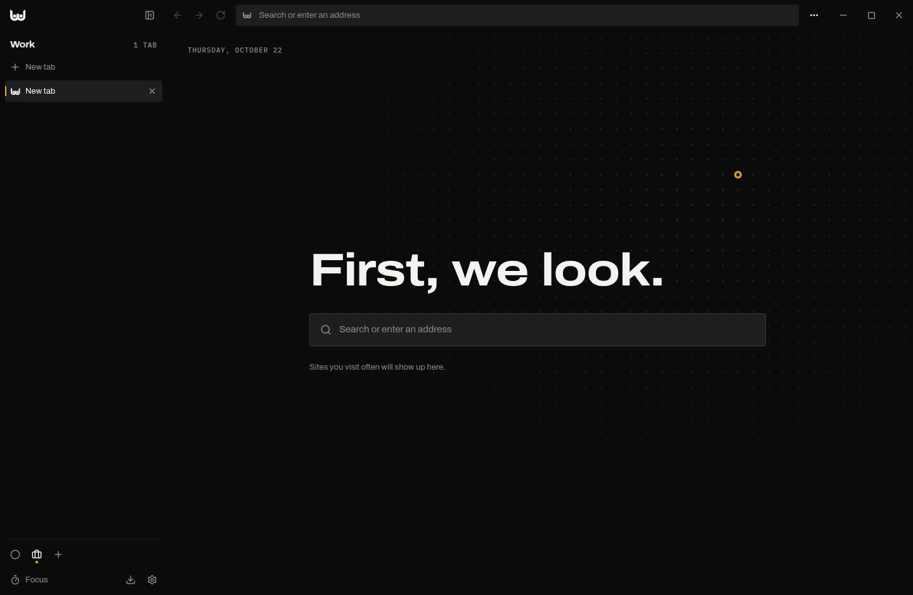
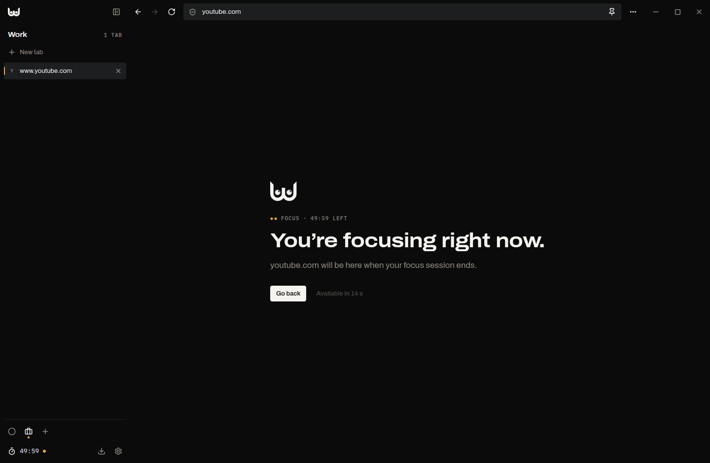

# PEEPWICK Browser

**A calm, private browser that guards your attention. First, we look.**

> **Alpha.** PEEPWICK Browser is in alpha: features may change and you may run into bugs.
> Releases are tagged with an `a` (v0.1.3a). Please [report what you find](https://github.com/PEEPWICK/peepwick-browser/issues/new?template=bug_report.yml).

PEEPWICK Browser is built on Chromium (through [Electron](https://www.electronjs.org/)) and shaped
by one idea from the PEEPWICK brand: attention is the scarcest thing online. It blocks ads and
trackers, keeps your spaces apart and helps you focus, inside a quiet black-and-white frame that
lets the pages you visit keep their own colour.



[Türkçe aşağıda](#türkçe)

## Features

- **Shield.** Ads and trackers are blocked with the EasyList, EasyPrivacy and uBlock Origin lists
  (through Ghostery's engine). Third-party cookies are blocked and the Global Privacy Control
  signal is sent. The shield shows what it blocked on each page and can be switched off per site.
  A strict level also hides cookie notices.
- **Focus.** Start a 25, 50 or 90-minute session and the sites you choose wait behind a calm gate
  until it ends. You can still open one for five minutes after a short pause. Site notifications
  are silenced while you focus.
- **Spaces and vertical tabs.** Tabs live in a sidebar, grouped into spaces (work, personal…).
  Pin tabs, drag them between spaces, open two side by side, and let unused tabs sleep.
- **Reader view.** One click turns an article into clean type set in Newsreader, shown with
  scripts disabled.
- **Bookmarks.** A bookmarks bar with folders, a full bookmark manager (folder tree, search,
  drag and drop, multi-select, undo) and the star in the address bar. Import from Chrome,
  Chromium, Brave, Edge, Vivaldi, Opera, Firefox, LibreWolf, Zen and Floorp (Snap and Flatpak
  installs included), or from an HTML file; export to HTML. Imports read the other browser's
  files on this computer and bring the site icons along.
- **Command bar.** <kbd>Ctrl</kbd>+<kbd>K</kbd> finds open tabs, bookmarks, history and commands.
- **Chrome extensions.** Install extensions from the Chrome Web Store. Most popular extensions
  work; some APIs are not available yet (see limitations).
- **Private windows** keep nothing after they close.
- **Automatic updates** from GitHub Releases.
- Turkish and English interface.



## Install

Download the latest release from the
[Releases page](https://github.com/PEEPWICK/peepwick-browser/releases):

- **AppImage** (any distribution): make it executable and run it.

  ```bash
  chmod +x peepwick-browser-*.AppImage
  ./peepwick-browser-*.AppImage
  ```

- **.deb** (Ubuntu, Debian, Zorin, Mint…):

  ```bash
  sudo apt install ./peepwick-browser-*-amd64.deb
  ```

Both update themselves: the browser checks GitHub Releases at startup and every four hours,
downloads new versions in the background and installs them on restart. The .deb update asks for
your password through the system dialog.

## Keyboard shortcuts

| Shortcut | Action |
| --- | --- |
| <kbd>Ctrl</kbd>+<kbd>T</kbd> / <kbd>Ctrl</kbd>+<kbd>W</kbd> | New tab / close tab |
| <kbd>Ctrl</kbd>+<kbd>Shift</kbd>+<kbd>T</kbd> | Reopen closed tab |
| <kbd>Ctrl</kbd>+<kbd>L</kbd> | Address bar |
| <kbd>Ctrl</kbd>+<kbd>K</kbd> | Command bar |
| <kbd>Ctrl</kbd>+<kbd>1</kbd>…<kbd>9</kbd> | Go to tab |
| <kbd>Alt</kbd>+<kbd>1</kbd>…<kbd>9</kbd> | Go to space |
| <kbd>Ctrl</kbd>+<kbd>B</kbd> | Show or hide the sidebar |
| <kbd>Ctrl</kbd>+<kbd>D</kbd> | Bookmark this page |
| <kbd>Ctrl</kbd>+<kbd>Shift</kbd>+<kbd>D</kbd> | Bookmark all tabs of the space |
| <kbd>Ctrl</kbd>+<kbd>Shift</kbd>+<kbd>B</kbd> | Show or hide the bookmarks bar |
| <kbd>Ctrl</kbd>+<kbd>Shift</kbd>+<kbd>O</kbd> | Bookmark manager |
| <kbd>Ctrl</kbd>+<kbd>Shift</kbd>+<kbd>S</kbd> | Side by side with the previous tab |
| <kbd>Ctrl</kbd>+<kbd>Alt</kbd>+<kbd>R</kbd> | Reader view |
| <kbd>Ctrl</kbd>+<kbd>F</kbd> | Find on page |
| <kbd>Ctrl</kbd>+<kbd>H</kbd> / <kbd>Ctrl</kbd>+<kbd>J</kbd> | History / downloads |
| <kbd>Ctrl</kbd>+<kbd>Shift</kbd>+<kbd>N</kbd> | Private window |

## What the browser sends, and where

PEEPWICK Browser has no telemetry and no account. It talks to these services on its own:

| Service | Why | When |
| --- | --- | --- |
| `raw.githubusercontent.com` | Filter lists for the shield | First start, then every three days |
| `github.com` (Releases) | Update checks and downloads | At startup and every four hours |
| Your search engine | Search suggestions | Only if you turn suggestions on (off by default) |
| Chrome Web Store | Installing and updating extensions | Only if you install extensions |

Pages you visit load as in any browser. Favicons are fetched once by the browser and kept locally.
Importing bookmarks reads the other browser's files on this computer; nothing leaves it.

## Build from source

Requirements: Node.js 24 and npm 11 on Linux.

```bash
npm ci
npm run dev        # run with hot reload
npm run typecheck
npm test
npm run dist       # build an AppImage and a .deb into dist/
```

`npm run icons` regenerates the app icons from the brand geometry, and `npm run social` the
social preview card in `docs/`.

## Releasing

1. Bump the version: `npm run release -- patch` (or `minor`, `major`). This commits and tags
   the release. `package.json` keeps a SemVer version (`0.1.3`) for the build tools and the
   updater; `releaseStage` adds the suffix people see: `alpha` → `v0.1.3a`, `beta` → `v0.1.3b`,
   `stable` → `v0.1.3`.
2. Push the commit and the tag: `git push --follow-tags`.
3. The **Release** workflow builds the AppImage and the .deb and publishes a GitHub release.
   Installed browsers see it within four hours, or right away from *Settings › About*.

## How it is built

- `src/main`: the Electron main process. Each window has one UI view and one
  `WebContentsView` per visible tab. All tabs are sandboxed, have no preload and no bridge to the
  main process. Built-in pages (new tab, settings, history, extensions), error screens and the
  focus gate are drawn by the UI itself, so web content never reaches a privileged page.
- `src/main/network.ts`: one request pipeline per session (Electron allows a single listener),
  running the focus gate, the shield, third-party cookie blocking and Global Privacy Control.
- `src/renderer`: the UI in React, styled with the PEEPWICK brand tokens: Gece, Beyaz, warm
  greys and one Fitil amber accent; Archivo, Newsreader and IBM Plex Mono.
- `src/shared`: types, the IPC contract, translations and pure helpers shared by both sides.
- History is stored with Node's built-in `node:sqlite`; the app ships no native modules.

## Known limitations

- Linux only for now.
- Netflix, Spotify and other DRM-protected video don't play (Widevine is not available in Electron).
- Extensions that rely on `chrome.webRequest` don't receive events, because the shield owns the
  request pipeline. Extensions run in normal windows only.

## License

PEEPWICK Browser is free software under the [GNU General Public License v3.0](LICENSE).
It includes Chromium and Electron (BSD and MIT), Ghostery's adblocker (MPL-2.0),
electron-chrome-extensions (GPL-3.0), Mozilla Readability (Apache-2.0), and the Archivo,
Newsreader and IBM Plex Mono typefaces (SIL Open Font License 1.1).

The PEEPWICK name and the Double-Eye W mark identify PEEPWICK and are not part of the GPL grant.
If you distribute a modified version, please give it your own name and icon.

---

## Türkçe

**Dikkatinizi koruyan, sakin ve gizli bir tarayıcı. Önce bakarız.**

> **Alpha.** PEEPWICK Browser alpha aşamasında: özellikler değişebilir, hatalarla
> karşılaşabilirsiniz. Sürüm etiketleri `a` ile biter (v0.1.3a).

PEEPWICK Browser, Chromium tabanlıdır (Electron ile) ve PEEPWICK markasının bir fikrine dayanır:
dijital dünyanın en kıt kaynağı dikkattir. Reklamları ve izleyicileri engeller, alanlarınızı
ayrı tutar, odaklanmanıza yardım eder. Siyah-beyaz, sakin bir çerçeve sunar; gezdiğiniz
sayfalar kendi renkleriyle kalır.

### Özellikler

- **Kalkan:** EasyList, EasyPrivacy ve uBlock Origin listeleriyle reklam ve izleyici engelleme,
  üçüncü taraf çerez engelleme, Global Privacy Control sinyali. Her sayfada neyin engellendiğini
  gösterir; site bazında kapatılabilir. "Sıkı" düzey çerez bildirimlerini de gizler.
- **Odak:** 25, 50 ya da 90 dakikalık oturumlar. Seçtiğiniz siteler oturum boyunca sakin bir
  ekranın arkasında bekler. Kısa bir beklemeden sonra bir siteyi beş dakikalığına açabilirsiniz.
- **Alanlar ve dikey sekmeler:** Sekmeler kenar çubuğunda, iş ve kişisel gibi alanlarda durur.
  Sabitleme, alanlar arası sürükleme, yan yana görünüm ve kullanılmayan sekmeleri uyutma.
- **Okuma modu:** Makaleyi Newsreader ile dizilmiş, betikleri kapalı temiz bir sayfaya çevirir.
- **Yer imleri:** Klasörlü yer imi çubuğu, tam bir yer imi yöneticisi (klasör ağacı, arama,
  sürükle-bırak, çoklu seçim, geri alma) ve adres çubuğundaki yıldız (<kbd>Ctrl</kbd>+<kbd>D</kbd>).
  Chrome, Chromium, Brave, Edge, Vivaldi, Opera, Firefox, LibreWolf, Zen ve Floorp'tan (Snap ve
  Flatpak kurulumları dahil) ya da bir HTML dosyasından içe aktarma; HTML olarak dışa aktarma.
  İçe aktarma yalnızca bu bilgisayardaki dosyaları okur, site simgelerini de getirir.
- **Komut çubuğu:** <kbd>Ctrl</kbd>+<kbd>K</kbd> ile açık sekmeler, yer imleri, geçmiş ve komutlar.
- **Chrome eklentileri:** Chrome Web Mağazası'ndan eklenti kurabilirsiniz.
- **Gizli pencere** kapanınca hiçbir şey bırakmaz.
- **Otomatik güncelleme** (GitHub Releases üzerinden).

### Kurulum

[Releases sayfasından](https://github.com/PEEPWICK/peepwick-browser/releases) AppImage ya da
.deb dosyasını indirin. İkisi de kendini günceller: tarayıcı açılışta ve dört saatte bir yeni
sürümü denetler, arka planda indirir ve yeniden başlatınca kurar.

### Sürüm yayınlama

```bash
npm run release -- patch
git push --follow-tags
```

Etiket gönderildiğinde **Release** iş akışı AppImage ve .deb paketlerini derleyip GitHub'da
yayınlar. Kurulu tarayıcılar yeni sürümü dört saat içinde, ya da *Ayarlar › Hakkında*
bölümünden hemen alır.

### Lisans

GPL-3.0. PEEPWICK adı ve Çift Göz W işareti GPL kapsamında değildir; değiştirilmiş bir sürüm
dağıtırsanız kendi ad ve simgenizi kullanın.
