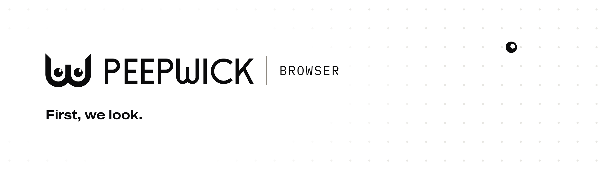
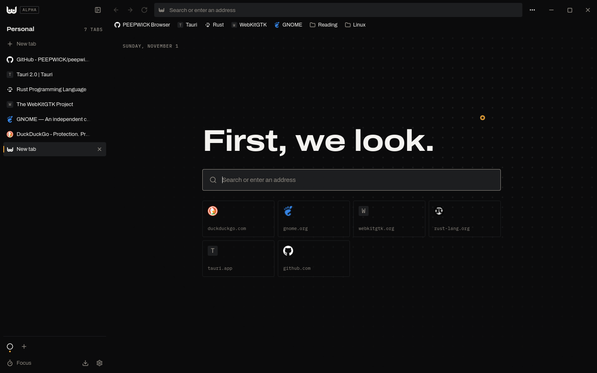
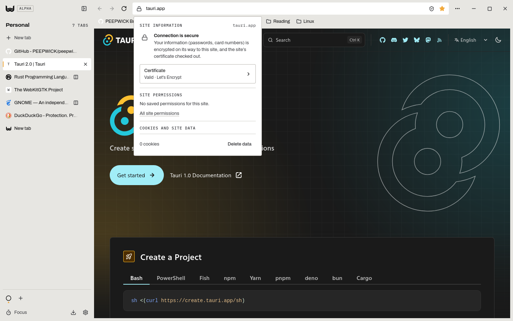

<p align="center">
  <picture>
    <source media="(prefers-color-scheme: dark)" srcset="docs/brand/banner-dark.png">
    
  </picture>
</p>

<h3 align="center">The browser that guards your attention.</h3>

<p align="center">
  <a href="https://github.com/PEEPWICK/peepwick-browser/releases/tag/v0.2.7a"><b>Download for Linux</b></a>
  &nbsp;·&nbsp;
  <a href="#what-the-browser-sends-and-where">Privacy</a>
  &nbsp;·&nbsp;
  <a href="#keyboard-shortcuts">Shortcuts</a>
  &nbsp;·&nbsp;
  <a href="#build-from-source">Build from source</a>
</p>

<p align="center"><sub>ALPHA · LINUX · OPEN SOURCE · GPL-3.0</sub></p>

Most of the day happens in a browser, and most of the web is built to pull your attention apart.
PEEPWICK Browser filters out the ads and trackers, keeps your work and your evenings in separate
spaces, holds distracting sites back while you focus, and stays quiet: a black-and-white frame
that lets the pages you visit keep their own color.

It is written in Rust with [Tauri](https://tauri.app/), and draws pages with
[WebKitGTK](https://webkitgtk.org/), the engine of GNOME Web.



## A quiet frame

- **Spaces and vertical tabs.** Tabs live in a sidebar, grouped into spaces such as work and
  personal. Pin them, move them between spaces, open two side by side, and let the ones you aren't
  using sleep. Close the browser and everything comes back next time: windows, spaces and tabs,
  each tab with its back and forward history.
- **Focus sessions.** Start one for 25, 50 or 90 minutes from the sidebar, and the sites that pull
  you away (YouTube, X, Instagram, TikTok, Reddit and a few more, or your own list) wait behind a
  calm screen instead of loading. Need one anyway? It opens for five minutes after a short pause.
  Sites stay quiet too: no notifications until the session ends.
- **Reader view, a reading list and read aloud.** Articles open without the clutter around them, in
  the browser's own typefaces, light or dark (<kbd>Ctrl</kbd>+<kbd>Alt</kbd>+<kbd>R</kbd>). Keep
  pages to read later from the menu or a link's right-click menu: the reading list keeps the
  article itself, so it opens offline. Read aloud speaks an article paragraph by paragraph with
  your system's voices, at the speed you choose.
- **One bar for everything.** The address bar suggests from your history, your bookmarks and your
  open tabs. <kbd>Ctrl</kbd>+<kbd>K</kbd> opens the command bar for commands, tabs and bookmarks.
  Search with DuckDuckGo, Brave Search, Startpage, Google, Ecosia or Bing; suggestions from your
  search engine come only if you turn them on.
- **Bookmarks.** A bookmarks bar with folders, a bookmark manager with search, drag and drop and
  undo, and the star in the address bar (<kbd>Ctrl</kbd>+<kbd>D</kbd>). Bring your bookmarks,
  history and passwords over from Chrome, Brave, Firefox and the other browsers on your computer,
  Firefox profiles with a primary password too. Bookmarks also come in the HTML file every browser
  exports, and passwords in a CSV export from Chrome, Firefox, Bitwarden, 1Password, LastPass or
  KeePassXC; both go back out the same way.
- **Pages of its own, in the same calm style.** The new tab page shows the sites you visit most;
  history, downloads, bookmarks and settings sit in the same frame. Turkish or English; dark,
  light or your system's theme.

## Private by default

- **Shield.** Ads and trackers are blocked with the EasyList and EasyPrivacy lists, compiled into
  WebKit's own content blocking rules. If a site needs it, switch the shield off for that site
  alone.
- **Dangerous site warnings.** Sites known for malware or phishing don't open; a warning stands in
  their place. The lists come from the malware-filter project and are checked on your computer, so
  the addresses you visit never leave the browser.
- **Fingerprinting protection.** Canvas, WebGL and audio readouts get tiny changes that differ for
  every site and every session. The graphics card model is hidden and the processor count rounded,
  so sites can't recognize you from one site to the next.
- **Cookie banners, rejected.** When a consent notice from a common tool shows up, its "reject"
  button is pressed for you.
- **Third-party cookies blocked,** and WebKit's Intelligent Tracking Prevention on.
- **Global Privacy Control.** Every request asks sites not to sell or share your data
  (`Sec-GPC: 1`), and pages that check in script get the same answer.
- **Clear browsing data** with <kbd>Ctrl</kbd>+<kbd>Shift</kbd>+<kbd>Delete</kbd>: history and
  downloads from the last hour, day, week or four weeks, or from all time, along with cookies and
  site data, the cache and site permissions. Choose what goes every time the browser closes; if
  it was shut down before it could, that goes before any page opens next time.
- **Private windows** write nothing to disk; their data is gone when the last one closes.
- **No telemetry, no account.** The browser doesn't measure how you use it. See
  [what it sends, and where](#what-the-browser-sends-and-where).

## Security you can see



- **Site information.** The button at the left of the address bar shows whether the connection is
  secure. Open it for the certificate (who issued it, the names it covers, validity, fingerprints,
  chain), the site's permissions and cookies, and to delete what the site stored.
- **HTTPS-Only.** Sites open over an encrypted connection. When a site has no secure version, the
  browser asks before it continues over HTTP. Addresses on your own network are left alone.
- **Certificate warnings.** A page with a certificate problem waits behind a warning until you
  decide.
- **Site permissions.** Location, camera, microphone and notifications are asked for above the
  page, never granted silently. Answers can be remembered per site and changed in Settings.
- **Passwords.** After you sign in, the browser offers to save or update the password. Next time a
  short list under the field fills it in, only on the same site and only when you pick it. Sign-up
  forms get a strong password on request. Passwords are encrypted with a key your desktop's keyring
  keeps (GNOME Keyring, KWallet), and the passwords page checks for weak and reused ones on your
  computer.
- **Signed updates.** The browser looks for a new version at startup and every four hours,
  downloads it in the background and installs it when you restart. It installs nothing whose
  signature doesn't match.

## Everyday tools

Downloads with progress and speed: open, show in folder, retry, move to the trash; choose the
folder, or be asked where to save each file. Per-site zoom with a default zoom and font size.
Find on page, print, save a page as one .mhtml file, and the Web Inspector (<kbd>F12</kbd>).
Spelling suggestions in text fields. Make it your default browser from Settings or the welcome
screen, from the .deb or the AppImage alike. Links from other apps open as new tabs in the window
you used last, and a second launch never starts a second browser on the same profile. Play, pause
and mute what plays in any tab from the toolbar, sound from a page's frames included. The task
manager (<kbd>Shift</kbd>+<kbd>Esc</kbd>) shows the memory and processor use of each tab and
process, and ends a page that hangs. Back up your settings, bookmarks, spaces, focus history and
site permissions, and if you choose your open tabs, passwords and history, into one file encrypted
with a password of yours. Restoring it on another computer adds what's missing and deletes nothing.
When something breaks, Settings › Report a bug shows a short report (version, system, error codes,
never addresses or file names) to copy, or to send to GitHub's bug form with the details filled in.

## Install

Download the newest version, **0.2.7a**, from its
[release page](https://github.com/PEEPWICK/peepwick-browser/releases/tag/v0.2.7a):

- **AppImage**, for any distribution. It carries its own WebKitGTK and GStreamer:

  ```bash
  chmod +x peepwick-browser-0.2.7a-x86_64.AppImage
  ./peepwick-browser-0.2.7a-x86_64.AppImage
  ```

- **.deb**, for Ubuntu, Debian, Zorin, Mint and their relatives. It uses your system's WebKitGTK,
  which keeps the package at about 5 MB:

  ```bash
  sudo apt install ./peepwick-browser-0.2.7a-amd64.deb
  ```

Both update themselves: the AppImage replaces its own file, and the .deb asks for your password
through the system dialog when you restart the browser.

PEEPWICK Browser is in alpha. The release notes of each version list what changed and the known
issues. If something doesn't work the way you expect,
[tell us](https://github.com/PEEPWICK/peepwick-browser/issues/new?template=bug_report.yml).

The browser keeps its data in `~/.local/share/com.peepwick.browser` and its cache in
`~/.cache/com.peepwick.browser`.

## Keyboard shortcuts

| Shortcut | Action |
| --- | --- |
| <kbd>Ctrl</kbd>+<kbd>T</kbd> / <kbd>Ctrl</kbd>+<kbd>W</kbd> | New tab / close tab |
| <kbd>Ctrl</kbd>+<kbd>Shift</kbd>+<kbd>T</kbd> | Reopen closed tab |
| <kbd>Ctrl</kbd>+<kbd>Tab</kbd> / <kbd>Ctrl</kbd>+<kbd>Shift</kbd>+<kbd>Tab</kbd> | Next / previous tab |
| <kbd>Ctrl</kbd>+<kbd>1</kbd>…<kbd>9</kbd> | Go to tab |
| <kbd>Alt</kbd>+<kbd>1</kbd>…<kbd>9</kbd> | Go to space |
| <kbd>Ctrl</kbd>+<kbd>L</kbd> | Address bar |
| <kbd>Ctrl</kbd>+<kbd>K</kbd> | Command bar |
| <kbd>Ctrl</kbd>+<kbd>B</kbd> | Show or hide the sidebar |
| <kbd>Ctrl</kbd>+<kbd>Shift</kbd>+<kbd>S</kbd> | Side by side with the previous tab |
| <kbd>Ctrl</kbd>+<kbd>D</kbd> | Bookmark this page |
| <kbd>Ctrl</kbd>+<kbd>Shift</kbd>+<kbd>D</kbd> | Bookmark all tabs of the space |
| <kbd>Ctrl</kbd>+<kbd>Shift</kbd>+<kbd>B</kbd> | Show or hide the bookmarks bar |
| <kbd>Ctrl</kbd>+<kbd>Shift</kbd>+<kbd>O</kbd> | Bookmark manager |
| <kbd>Ctrl</kbd>+<kbd>F</kbd> | Find on page |
| <kbd>Ctrl</kbd>+<kbd>Alt</kbd>+<kbd>R</kbd> | Reader view |
| <kbd>Ctrl</kbd>+<kbd>H</kbd> / <kbd>Ctrl</kbd>+<kbd>J</kbd> | History / downloads |
| <kbd>Ctrl</kbd>+<kbd>Shift</kbd>+<kbd>Delete</kbd> | Clear browsing data |
| <kbd>Shift</kbd>+<kbd>Esc</kbd> | Task manager |
| <kbd>Ctrl</kbd>+<kbd>S</kbd> / <kbd>Ctrl</kbd>+<kbd>P</kbd> | Save page / print |
| <kbd>Ctrl</kbd>+<kbd>=</kbd> / <kbd>Ctrl</kbd>+<kbd>-</kbd> / <kbd>Ctrl</kbd>+<kbd>0</kbd> | Zoom in / out / reset |
| <kbd>Ctrl</kbd>+<kbd>N</kbd> / <kbd>Ctrl</kbd>+<kbd>Shift</kbd>+<kbd>N</kbd> | New window / private window |
| <kbd>F11</kbd> / <kbd>F12</kbd> | Full screen / Web Inspector |

Shortcuts keep working when you switch to a Cyrillic, Greek or any other keyboard layout.

## What the browser sends, and where

PEEPWICK Browser has no telemetry and no account. On its own, it talks only to these services:

| Service | Why | When |
| --- | --- | --- |
| `easylist.to` | Filter lists for the shield | First start, then every three days |
| `malware-filter.gitlab.io` | Lists of dangerous sites for the warnings (from its mirror, `curbengh.github.io`, when it doesn't answer) | First start, then every 12 hours |
| `raw.githubusercontent.com` | The update list: the newest version and its signatures | 15 seconds after start, then every four hours |
| `github.com` (Releases) | Downloading an update | Only when there is a new version |
| Your search engine | Search suggestions | Only if you turn suggestions on (off by default) |

Pages you visit load as in any browser, and WebKit fetches their icons along with them. A link you
add to the reading list loads out of sight, to keep its article. "Copy image" fetches the image
again from its site. Notifications from sites you allow go through your desktop's
notification service. The error log behind "Report a bug" stays on this computer (in a file only
if you turn that on); it reaches GitHub only when you send a report yourself. Importing reads the
other browser's files on this computer; nothing leaves it. For Chromium-based browsers, the key
their passwords are encrypted with is read from your desktop's keyring.

## Build from source

You need Linux, Node.js 24, Rust (stable, through [rustup](https://rustup.rs/)) and these packages:

```bash
sudo apt install build-essential pkg-config libwebkit2gtk-4.1-dev libssl-dev libxdo-dev \
  libayatana-appindicator3-dev librsvg2-dev
```

```bash
npm ci
npm run dev        # the interface with hot reload, and a debug build of the browser
npm run typecheck
npm test           # interface tests
cargo test --manifest-path src-tauri/Cargo.toml   # Rust tests
npm run build      # a .deb and an AppImage in src-tauri/target/release/bundle/
```

The AppImage carries GStreamer's plugins; to bundle them, the build needs `patchelf` and the plugins
themselves (`gstreamer1.0-plugins-base`, `gstreamer1.0-plugins-good`, `gstreamer1.0-libav`).
`npm run icons` draws the app icons from the brand geometry, and the banners at the top of this
page come from [`docs/brand/banners.html`](docs/brand/banners.html).

## Releasing

1. Bump the version: `npm run release -- patch` (or `minor`, `major`). This updates package.json
   and the Rust crate, commits and tags the release. package.json keeps a SemVer version (`0.2.1`);
   `releaseStage` adds the suffix people see: `alpha` → `v0.2.1a`, `beta` → `v0.2.1b`,
   `stable` → `v0.2.1`.
2. Push the commit and the tag: `git push --follow-tags`.
3. The **Release** workflow builds the .deb and the AppImage, signs them with the
   `TAURI_SIGNING_PRIVATE_KEY` secret (the matching public key is in `src-tauri/tauri.conf.json`),
   publishes a GitHub release and writes the update list, `latest.json`, into the `updates` branch,
   where installed copies look. While `githubPrerelease` is `true` in package.json, releases are
   marked as pre-releases.

Keep a copy of the private signing key somewhere safe: without it, no update can reach the copies
already installed.

## How it is built

- `src-tauri/src`: the browser, in Rust. Tauri 2 runs the window and the interface; every tab is a
  WebKitGTK view managed from Rust and stacked with the interface in a GTK overlay. The interface
  sits under the pages and rises above them, transparent, while a menu or a dialog is open.
  Built-in pages (new tab, settings, history) and error screens are drawn by the interface, so
  web content never reaches a privileged page.
- The shield: adblock-rust turns the filter lists into WebKit content rules, which WebKit compiles
  once and keeps in the profile. Dangerous site warnings look each page's address up in the
  malware-filter lists, kept on disk and in memory.
- Reader view runs Mozilla's Readability in a script world of its own and shows the article in a
  WebKit view of its own, with scripts off. Read aloud talks to speech-dispatcher, the speech
  service of Linux desktops, over its socket.
- History and site icons are stored in SQLite (rusqlite); bookmarks, downloads and site permissions
  in JSON files.
- Fingerprinting protection, cookie banner rejection and Global Privacy Control's
  `navigator.globalPrivacyControl` are WebKit user scripts (`src-tauri/scripts`); cookie banners
  are handled in a world of their own, the rest in the page's own world.
- `src-tauri/webext`: a small extension WebKit loads into its web processes. It adds the Global
  Privacy Control header to every request a page makes and moves a page's own HTTP address to
  HTTPS before the request leaves, which WebKitGTK gives the browser itself no way to do.
- Updates come through Tauri's updater; packages are checked against a minisign signature that has
  to name the version the update list announces.
- `src/renderer`: the interface in React, styled with the PEEPWICK brand tokens: near-black and
  white, warm greys and a single amber accent; Archivo, Newsreader and IBM Plex Mono.
- `src/shared`: types, the contract between the interface and Rust, and the translations. The Rust
  side builds the same dictionaries in.

## License

PEEPWICK Browser is free software under the [GNU General Public License v3.0](LICENSE).
It includes WebKitGTK (LGPL-2.1 and BSD), Tauri (MIT or Apache-2.0), the gtk-rs and webkit2gtk-rs
bindings (MIT), adblock-rust (MPL-2.0), SQLite (public domain) through rusqlite (MIT), React (MIT),
Mozilla's Readability (Apache-2.0), and the Archivo, Newsreader and IBM Plex Mono typefaces (SIL
Open Font License 1.1). The AppImage also carries GStreamer and its plugins (LGPL-2.1).

The PEEPWICK name and the Double-Eye W mark identify PEEPWICK and are not part of the GPL grant.
If you distribute a modified version, please give it your own name and icon.

PEEPWICK Browser is made by [PEEPWICK](https://github.com/PEEPWICK). First, we look.
