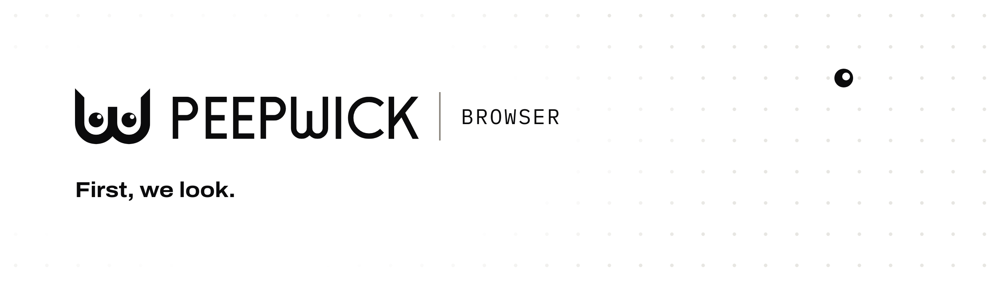
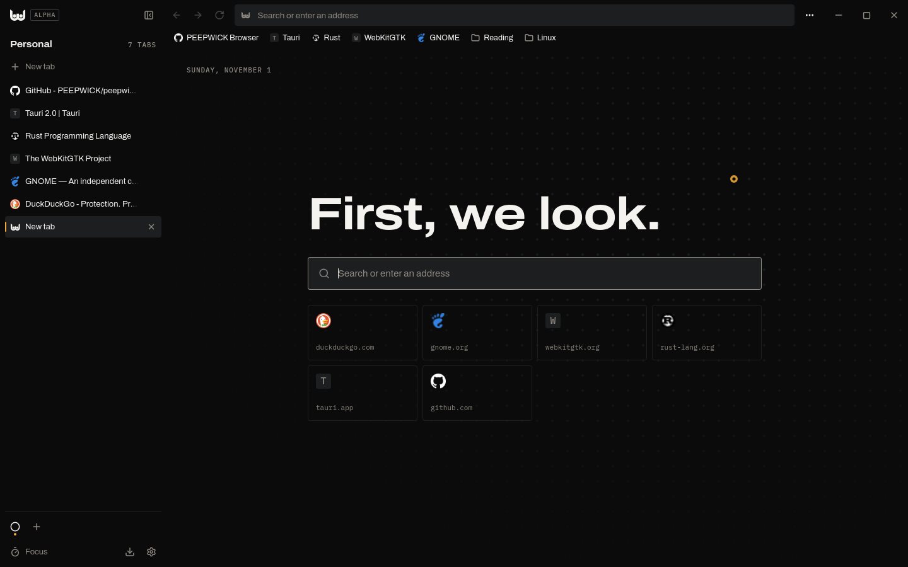
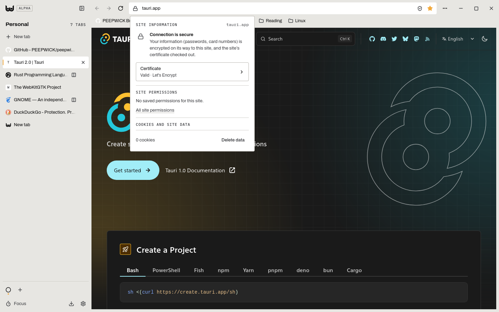

<p align="center">
  <picture>
    <source media="(prefers-color-scheme: dark)" srcset="docs/brand/banner-dark.png">
    
  </picture>
</p>

<h3 align="center">The browser that guards your attention.</h3>

<p align="center">
  <a href="https://github.com/PEEPWICK/peepwick-browser/releases/tag/v0.2.1a"><b>Download for Linux</b></a>
  &nbsp;·&nbsp;
  <a href="#what-the-browser-sends-and-where">Privacy</a>
  &nbsp;·&nbsp;
  <a href="#keyboard-shortcuts">Shortcuts</a>
  &nbsp;·&nbsp;
  <a href="#build-from-source">Build from source</a>
  &nbsp;·&nbsp;
  <a href="#türkçe">Türkçe</a>
</p>

<p align="center"><sub>ALPHA · LINUX · OPEN SOURCE · GPL-3.0</sub></p>

Most of the day happens in a browser, and most of the web is built to pull your attention apart.
PEEPWICK Browser filters out the ads and trackers, keeps your work and your evenings in separate
spaces, and stays quiet: a black-and-white frame that lets the pages you visit keep their own
color.

It is written in Rust with [Tauri](https://tauri.app/), and draws pages with
[WebKitGTK](https://webkitgtk.org/), the engine of GNOME Web.



## A quiet frame

- **Spaces and vertical tabs.** Tabs live in a sidebar, grouped into spaces such as work and
  personal. Pin them, move them between spaces, open two side by side, and let the ones you aren't
  using sleep. Close the browser and everything comes back next time: windows, spaces and tabs,
  each tab with its back and forward history.
- **One bar for everything.** The address bar suggests from your history, your bookmarks and your
  open tabs. <kbd>Ctrl</kbd>+<kbd>K</kbd> opens the command bar for commands, tabs and bookmarks.
  Search with DuckDuckGo, Brave Search, Startpage, Google, Ecosia or Bing; suggestions from your
  search engine come only if you turn them on.
- **Bookmarks.** A bookmarks bar with folders, a bookmark manager with search, drag and drop and
  undo, and the star in the address bar (<kbd>Ctrl</kbd>+<kbd>D</kbd>). Bring your bookmarks
  over in the HTML file every browser exports, and take them with you the same way.
- **Pages of its own, in the same calm style.** The new tab page shows the sites you visit most;
  history, downloads, bookmarks and settings sit in the same frame. Turkish or English; dark,
  light or your system's theme.

## Private by default

- **Shield.** Ads and trackers are blocked with the EasyList and EasyPrivacy lists, compiled into
  WebKit's own content blocking rules. If a site needs it, switch the shield off for that site
  alone.
- **Fingerprinting protection.** Canvas, WebGL and audio readouts get tiny changes that differ for
  every site and every session. The graphics card model is hidden and the processor count rounded,
  so sites can't recognize you from one site to the next.
- **Cookie banners, rejected.** When a consent notice from a common tool shows up, its "reject"
  button is pressed for you.
- **Third-party cookies blocked,** and WebKit's Intelligent Tracking Prevention on.
- **Private windows** write nothing to disk; their data is gone when the last one closes.
- **No telemetry, no account.** The browser doesn't measure how you use it. See
  [what it sends, and where](#what-the-browser-sends-and-where).

## Security you can see



- **Site information.** The button at the left of the address bar shows whether the connection is
  secure. Open it for the certificate (who issued it, the names it covers, validity, fingerprints,
  chain), the site's permissions and cookies, and to delete what the site stored.
- **HTTPS-Only.** Sites open over an encrypted connection. When a site has no secure version, the
  browser asks before it continues over HTTP. Addresses on your own network are left alone.
- **Certificate warnings.** A page with a certificate problem waits behind a warning until you
  decide.
- **Site permissions.** Location, camera, microphone and notifications are asked for above the
  page, never granted silently. Answers can be remembered per site and changed in Settings.
- **Signed updates.** The browser looks for a new version at startup and every four hours,
  downloads it in the background and installs it when you restart. It installs nothing whose
  signature doesn't match.

## Everyday tools

Downloads with progress and speed: open, show in folder, retry, move to the trash; choose the
folder, or be asked where to save each file. Per-site zoom with a default zoom and font size.
Find on page, print, save a page as one .mhtml file, and the Web Inspector (<kbd>F12</kbd>).
Spelling suggestions in text fields. Links from other apps open as new tabs in the window you used
last, and a second launch never starts a second browser on the same profile.

## Install

Download the newest version, **0.2.1a**, from its
[release page](https://github.com/PEEPWICK/peepwick-browser/releases/tag/v0.2.1a):

- **AppImage**, for any distribution. It carries its own WebKitGTK and GStreamer:

  ```bash
  chmod +x peepwick-browser-0.2.1a-x86_64.AppImage
  ./peepwick-browser-0.2.1a-x86_64.AppImage
  ```

- **.deb**, for Ubuntu, Debian, Zorin, Mint and their relatives. It uses your system's WebKitGTK,
  which keeps the package at about 5 MB:

  ```bash
  sudo apt install ./peepwick-browser-0.2.1a-amd64.deb
  ```

Both update themselves: the AppImage replaces its own file, and the .deb asks for your password
through the system dialog when you restart the browser.

PEEPWICK Browser is in alpha. The release notes of each version list what changed and the known
issues. If something doesn't work the way you expect,
[tell us](https://github.com/PEEPWICK/peepwick-browser/issues/new?template=bug_report.yml).

The browser keeps its data in `~/.local/share/com.peepwick.browser` and its cache in
`~/.cache/com.peepwick.browser`.

## Keyboard shortcuts

| Shortcut | Action |
| --- | --- |
| <kbd>Ctrl</kbd>+<kbd>T</kbd> / <kbd>Ctrl</kbd>+<kbd>W</kbd> | New tab / close tab |
| <kbd>Ctrl</kbd>+<kbd>Shift</kbd>+<kbd>T</kbd> | Reopen closed tab |
| <kbd>Ctrl</kbd>+<kbd>Tab</kbd> / <kbd>Ctrl</kbd>+<kbd>Shift</kbd>+<kbd>Tab</kbd> | Next / previous tab |
| <kbd>Ctrl</kbd>+<kbd>1</kbd>…<kbd>9</kbd> | Go to tab |
| <kbd>Alt</kbd>+<kbd>1</kbd>…<kbd>9</kbd> | Go to space |
| <kbd>Ctrl</kbd>+<kbd>L</kbd> | Address bar |
| <kbd>Ctrl</kbd>+<kbd>K</kbd> | Command bar |
| <kbd>Ctrl</kbd>+<kbd>B</kbd> | Show or hide the sidebar |
| <kbd>Ctrl</kbd>+<kbd>Shift</kbd>+<kbd>S</kbd> | Side by side with the previous tab |
| <kbd>Ctrl</kbd>+<kbd>D</kbd> | Bookmark this page |
| <kbd>Ctrl</kbd>+<kbd>Shift</kbd>+<kbd>D</kbd> | Bookmark all tabs of the space |
| <kbd>Ctrl</kbd>+<kbd>Shift</kbd>+<kbd>B</kbd> | Show or hide the bookmarks bar |
| <kbd>Ctrl</kbd>+<kbd>Shift</kbd>+<kbd>O</kbd> | Bookmark manager |
| <kbd>Ctrl</kbd>+<kbd>F</kbd> | Find on page |
| <kbd>Ctrl</kbd>+<kbd>H</kbd> / <kbd>Ctrl</kbd>+<kbd>J</kbd> | History / downloads |
| <kbd>Ctrl</kbd>+<kbd>S</kbd> / <kbd>Ctrl</kbd>+<kbd>P</kbd> | Save page / print |
| <kbd>Ctrl</kbd>+<kbd>=</kbd> / <kbd>Ctrl</kbd>+<kbd>-</kbd> / <kbd>Ctrl</kbd>+<kbd>0</kbd> | Zoom in / out / reset |
| <kbd>Ctrl</kbd>+<kbd>N</kbd> / <kbd>Ctrl</kbd>+<kbd>Shift</kbd>+<kbd>N</kbd> | New window / private window |
| <kbd>F11</kbd> / <kbd>F12</kbd> | Full screen / Web Inspector |

Shortcuts keep working when you switch to a Cyrillic, Greek or any other keyboard layout.

## What the browser sends, and where

PEEPWICK Browser has no telemetry and no account. On its own, it talks only to these services:

| Service | Why | When |
| --- | --- | --- |
| `easylist.to` | Filter lists for the shield | First start, then every three days |
| `raw.githubusercontent.com` | The update list: the newest version and its signatures | 15 seconds after start, then every four hours |
| `github.com` (Releases) | Downloading an update | Only when there is a new version |
| Your search engine | Search suggestions | Only if you turn suggestions on (off by default) |

Pages you visit load as in any browser, and WebKit fetches their icons along with them. "Copy image"
fetches the image again from its site. Notifications from sites you allow go through your desktop's
notification service.

## Build from source

You need Linux, Node.js 24, Rust (stable, through [rustup](https://rustup.rs/)) and these packages:

```bash
sudo apt install build-essential pkg-config libwebkit2gtk-4.1-dev libssl-dev libxdo-dev \
  libayatana-appindicator3-dev librsvg2-dev
```

```bash
npm ci
npm run dev        # the interface with hot reload, and a debug build of the browser
npm run typecheck
npm test           # interface tests
cargo test --manifest-path src-tauri/Cargo.toml   # Rust tests
npm run build      # a .deb and an AppImage in src-tauri/target/release/bundle/
```

The AppImage carries GStreamer's plugins; to bundle them, the build needs `patchelf` and the plugins
themselves (`gstreamer1.0-plugins-base`, `gstreamer1.0-plugins-good`, `gstreamer1.0-libav`).
`npm run icons` draws the app icons from the brand geometry, and the banners at the top of this
page come from [`docs/brand/banners.html`](docs/brand/banners.html).

## Releasing

1. Bump the version: `npm run release -- patch` (or `minor`, `major`). This updates package.json
   and the Rust crate, commits and tags the release. package.json keeps a SemVer version (`0.2.1`);
   `releaseStage` adds the suffix people see: `alpha` → `v0.2.1a`, `beta` → `v0.2.1b`,
   `stable` → `v0.2.1`.
2. Push the commit and the tag: `git push --follow-tags`.
3. The **Release** workflow builds the .deb and the AppImage, signs them with the
   `TAURI_SIGNING_PRIVATE_KEY` secret (the matching public key is in `src-tauri/tauri.conf.json`),
   publishes a GitHub release and writes the update list, `latest.json`, into the `updates` branch,
   where installed copies look. While `githubPrerelease` is `true` in package.json, releases are
   marked as pre-releases.

Keep a copy of the private signing key somewhere safe: without it, no update can reach the copies
already installed.

## How it is built

- `src-tauri/src`: the browser, in Rust. Tauri 2 runs the window and the interface; every tab is a
  WebKitGTK view managed from Rust and stacked with the interface in a GTK overlay. The interface
  sits under the pages and rises above them, transparent, while a menu or a dialog is open.
  Built-in pages (new tab, settings, history) and error screens are drawn by the interface, so
  web content never reaches a privileged page.
- The shield: adblock-rust turns the filter lists into WebKit content rules, which WebKit compiles
  once and keeps in the profile.
- History and site icons are stored in SQLite (rusqlite); bookmarks, downloads and site permissions
  in JSON files.
- Fingerprinting protection and cookie banner rejection are WebKit user scripts
  (`src-tauri/scripts`), one in the page's own world and one in a world of its own.
- Updates come through Tauri's updater; packages are checked against a minisign signature that has
  to name the version the update list announces.
- `src/renderer`: the interface in React, styled with the PEEPWICK brand tokens: Gece, Beyaz, warm
  greys and one Fitil amber accent; Archivo, Newsreader and IBM Plex Mono.
- `src/shared`: types, the contract between the interface and Rust, and the translations. The Rust
  side builds the same dictionaries in.

## License

PEEPWICK Browser is free software under the [GNU General Public License v3.0](LICENSE).
It includes WebKitGTK (LGPL-2.1 and BSD), Tauri (MIT or Apache-2.0), the gtk-rs and webkit2gtk-rs
bindings (MIT), adblock-rust (MPL-2.0), SQLite (public domain) through rusqlite (MIT), React (MIT),
and the Archivo, Newsreader and IBM Plex Mono typefaces (SIL Open Font License 1.1). The AppImage
also carries GStreamer and its plugins (LGPL-2.1).

The PEEPWICK name and the Double-Eye W mark identify PEEPWICK and are not part of the GPL grant.
If you distribute a modified version, please give it your own name and icon.

PEEPWICK Browser is made by [PEEPWICK](https://github.com/PEEPWICK). First, we look.

---

## Türkçe

<h3 align="center">Dikkatinizi koruyan tarayıcı.</h3>

<p align="center">
  <a href="https://github.com/PEEPWICK/peepwick-browser/releases/tag/v0.2.1a"><b>Linux için indirin</b></a>
  &nbsp;·&nbsp;
  <a href="#tarayıcı-neyi-nereye-gönderir">Gizlilik</a>
  &nbsp;·&nbsp;
  <a href="#klavye-kısayolları">Kısayollar</a>
  &nbsp;·&nbsp;
  <a href="#kaynaktan-derleme">Kaynaktan derleme</a>
</p>

Günümüzün büyük kısmı bir tarayıcıda geçiyor ve internetin çoğu dikkatinizi dağıtmak için
kurulmuş. PEEPWICK Browser reklamları ve izleyicileri ayıklar, işinizi ve kendinize ayırdığınız
zamanı ayrı alanlarda tutar ve sessiz kalır: siyah-beyaz, sakin bir çerçeve; gezdiğiniz sayfalar
kendi renkleriyle kalır.

Rust ve [Tauri](https://tauri.app/) ile yazıldı; sayfaları GNOME Web'in motoru
[WebKitGTK](https://webkitgtk.org/) çiziyor.

### Sakin bir çerçeve

- **Alanlar ve dikey sekmeler.** Sekmeler kenar çubuğunda, iş ve kişisel gibi alanlarda durur.
  Sabitleyin, alanlar arasında taşıyın, iki sekmeyi yan yana açın; kullanmadıklarınız uyusun.
  Tarayıcıyı kapattığınızda her şey bir sonraki açılışta geri gelir: pencereler, alanlar ve
  sekmeler, her sekme ileri ve geri geçmişiyle.
- **Her şey için tek çubuk.** Adres çubuğu geçmişinizden, yer imlerinizden ve açık sekmelerinizden
  öneri getirir. <kbd>Ctrl</kbd>+<kbd>K</kbd> komutlar, sekmeler ve yer imleri için komut
  çubuğunu açar. DuckDuckGo, Brave Search, Startpage, Google, Ecosia ya da Bing ile arayın; arama
  motorunuzun önerileri yalnızca siz açarsanız gelir.
- **Yer imleri.** Klasörlü yer imi çubuğu; arama, sürükle-bırak ve geri alma özellikli yer imi
  yöneticisi; adres çubuğundaki yıldız (<kbd>Ctrl</kbd>+<kbd>D</kbd>). Yer imlerinizi her
  tarayıcının dışa aktardığı HTML dosyasıyla getirin, aynı yolla yanınızda götürün.
- **Kendi sayfaları da aynı sakinlikte.** Yeni sekme sayfası en sık ziyaret ettiğiniz siteleri
  gösterir; geçmiş, indirmeler, yer imleri ve ayarlar aynı çerçevede durur. Türkçe ya da İngilizce;
  koyu, açık ya da sisteminizin teması.

### Varsayılan olarak gizli

- **Kalkan.** Reklamlar ve izleyiciler EasyList ve EasyPrivacy listeleriyle engellenir; listeler
  WebKit'in kendi içerik engelleme kurallarına çevrilir. Bir site gerektirirse kalkanı yalnızca o
  site için kapatın.
- **Parmak izi koruması.** Canvas, WebGL ve ses değerlerine her site ve her oturum için farklı,
  fark edilmeyecek kadar küçük değişiklikler katılır. Ekran kartı modeli gizlenir, işlemci sayısı
  yuvarlanır; siteler sizi bir siteden ötekine tanıyamaz.
- **Çerez bildirimlerine "hayır".** Yaygın onay araçlarından bir bildirim çıktığında "Reddet"
  düğmesine sizin yerinize basılır.
- **Üçüncü taraf çerezler engelli,** WebKit'in akıllı izleme önleme özelliği açık.
- **Gizli pencereler** diske hiçbir şey yazmaz; verileri son gizli pencereyle birlikte silinir.
- **Telemetri yok, hesap yok.** Tarayıcı onu nasıl kullandığınızı ölçmez. Neyi nereye gönderdiği
  [aşağıda](#tarayıcı-neyi-nereye-gönderir).

### Görünür güvenlik

- **Site bilgileri.** Adres çubuğunun solundaki düğme bağlantının güvenli olup olmadığını gösterir.
  Açınca sertifikayı (veren kuruluş, kapsadığı alan adları, geçerlilik, parmak izleri, zincir),
  sitenin izinlerini ve çerezlerini görür, sitenin sakladıklarını silebilirsiniz.
- **HTTPS-Only.** Siteler şifreli bağlantıyla açılır. Güvenli sürümü olmayan bir sitede tarayıcı
  HTTP ile devam etmeden önce size sorar. Kendi ağınızdaki adresler etkilenmez.
- **Sertifika uyarıları.** Sertifikasında sorun olan bir sayfa, siz karar verene kadar bir
  uyarının arkasında bekler.
- **Site izinleri.** Konum, kamera, mikrofon ve bildirim izinleri sayfanın üstünde sorulur, hiçbiri
  sessizce verilmez. Yanıtlar site başına hatırlanabilir, Ayarlar'dan değiştirilir.
- **İmzalı güncellemeler.** Tarayıcı açılışta ve dört saatte bir yeni sürüme bakar, arka planda
  indirir ve yeniden başlattığınızda kurar. İmzası tutmayan hiçbir şeyi kurmaz.

### Her gün işinize yarayanlar

İlerleme ve hız gösteren indirmeler: açma, klasörde gösterme, yeniden deneme, çöp kutusuna taşıma;
klasörü seçin ya da her dosyada nereye kaydedileceği sorulsun. Varsayılan yakınlaştırma ve yazı
boyutuyla site başına yakınlaştırma. Sayfada bulma, yazdırma, sayfayı tek bir .mhtml dosyası olarak
kaydetme ve Web Denetçisi (<kbd>F12</kbd>). Metin alanlarında yazım önerileri. Başka
uygulamalardan açılan bağlantılar en son kullandığınız pencerede yeni sekmede açılır; ikinci bir
açılış aynı profille ikinci bir tarayıcı başlatmaz.

### Kurulum

En yeni sürümü, **0.2.1a**'yı
[sürüm sayfasından](https://github.com/PEEPWICK/peepwick-browser/releases/tag/v0.2.1a) indirin:

- **AppImage**, her dağıtım için; kendi WebKitGTK ve GStreamer'ını taşır:

  ```bash
  chmod +x peepwick-browser-0.2.1a-x86_64.AppImage
  ./peepwick-browser-0.2.1a-x86_64.AppImage
  ```

- **.deb**, Ubuntu, Debian, Zorin, Mint ve benzerleri için. Sistemdeki WebKitGTK'yı kullandığı için
  paket yaklaşık 5 MB:

  ```bash
  sudo apt install ./peepwick-browser-0.2.1a-amd64.deb
  ```

İkisi de kendini günceller: AppImage kendi dosyasını yeniler, .deb ise tarayıcıyı yeniden
başlattığınızda parolanızı sistem penceresinden sorar.

PEEPWICK Browser alpha aşamasında. Her sürümün notlarında neyin değiştiği ve bilinen sorunlar yazar.
Bir şey beklediğiniz gibi çalışmazsa
[bize yazın](https://github.com/PEEPWICK/peepwick-browser/issues/new?template=bug_report.yml).

Tarayıcı verilerini `~/.local/share/com.peepwick.browser`, önbelleğini
`~/.cache/com.peepwick.browser` klasöründe tutar.

### Klavye kısayolları

| Kısayol | İşlev |
| --- | --- |
| <kbd>Ctrl</kbd>+<kbd>T</kbd> / <kbd>Ctrl</kbd>+<kbd>W</kbd> | Yeni sekme / sekmeyi kapat |
| <kbd>Ctrl</kbd>+<kbd>Shift</kbd>+<kbd>T</kbd> | Kapatılan sekmeyi yeniden aç |
| <kbd>Ctrl</kbd>+<kbd>Tab</kbd> / <kbd>Ctrl</kbd>+<kbd>Shift</kbd>+<kbd>Tab</kbd> | Sonraki / önceki sekme |
| <kbd>Ctrl</kbd>+<kbd>1</kbd>…<kbd>9</kbd> | Sekmeye git |
| <kbd>Alt</kbd>+<kbd>1</kbd>…<kbd>9</kbd> | Alana git |
| <kbd>Ctrl</kbd>+<kbd>L</kbd> | Adres çubuğu |
| <kbd>Ctrl</kbd>+<kbd>K</kbd> | Komut çubuğu |
| <kbd>Ctrl</kbd>+<kbd>B</kbd> | Kenar çubuğunu göster ya da gizle |
| <kbd>Ctrl</kbd>+<kbd>Shift</kbd>+<kbd>S</kbd> | Önceki sekmeyle yan yana |
| <kbd>Ctrl</kbd>+<kbd>D</kbd> | Sayfayı yer imlerine ekle |
| <kbd>Ctrl</kbd>+<kbd>Shift</kbd>+<kbd>D</kbd> | Alandaki tüm sekmeleri yer imlerine ekle |
| <kbd>Ctrl</kbd>+<kbd>Shift</kbd>+<kbd>B</kbd> | Yer imi çubuğunu göster ya da gizle |
| <kbd>Ctrl</kbd>+<kbd>Shift</kbd>+<kbd>O</kbd> | Yer imi yöneticisi |
| <kbd>Ctrl</kbd>+<kbd>F</kbd> | Sayfada bul |
| <kbd>Ctrl</kbd>+<kbd>H</kbd> / <kbd>Ctrl</kbd>+<kbd>J</kbd> | Geçmiş / indirmeler |
| <kbd>Ctrl</kbd>+<kbd>S</kbd> / <kbd>Ctrl</kbd>+<kbd>P</kbd> | Sayfayı kaydet / yazdır |
| <kbd>Ctrl</kbd>+<kbd>=</kbd> / <kbd>Ctrl</kbd>+<kbd>-</kbd> / <kbd>Ctrl</kbd>+<kbd>0</kbd> | Yakınlaştır / uzaklaştır / sıfırla |
| <kbd>Ctrl</kbd>+<kbd>N</kbd> / <kbd>Ctrl</kbd>+<kbd>Shift</kbd>+<kbd>N</kbd> | Yeni pencere / gizli pencere |
| <kbd>F11</kbd> / <kbd>F12</kbd> | Tam ekran / Web Denetçisi |

Kiril, Yunan ya da başka bir klavye düzenine geçtiğinizde de kısayollar çalışmaya devam eder.

### Tarayıcı neyi nereye gönderir?

Telemetri yok, hesap yok. Tarayıcı kendiliğinden yalnızca şu hizmetlere bağlanır:

| Hizmet | Neden | Ne zaman |
| --- | --- | --- |
| `easylist.to` | Kalkanın filtre listeleri | İlk açılışta, sonra üç günde bir |
| `raw.githubusercontent.com` | Güncelleme listesi: en yeni sürüm ve imzaları | Açılıştan 15 saniye sonra, sonra dört saatte bir |
| `github.com` (Releases) | Güncellemeyi indirmek | Yalnızca yeni sürüm olduğunda |
| Arama motorunuz | Arama önerileri | Yalnızca önerileri açarsanız (varsayılan olarak kapalı) |

Gezdiğiniz sayfalar her tarayıcıda olduğu gibi yüklenir; WebKit simgelerini de onlarla birlikte
alır. "Resmi kopyala" resmi kendi sitesinden yeniden indirir. İzin verdiğiniz sitelerin
bildirimleri masaüstünüzün bildirim hizmetinden geçer.

### Kaynaktan derleme

Gerekenler ve komutlar yukarıdaki [Build from source](#build-from-source) bölümünde; sürüm
yayınlama adımları [Releasing](#releasing) bölümünde. Kısaca:

```bash
npm ci && npm run build
npm run release -- patch
git push --follow-tags
```

Etiket gönderildiğinde **Release** iş akışı .deb ve AppImage paketlerini derler,
`TAURI_SIGNING_PRIVATE_KEY` gizli değişkeniyle imzalar, GitHub'da yayınlar ve güncelleme listesini
(`latest.json`) `updates` dalına yazar. İmza anahtarının bir kopyasını güvenli bir yerde saklayın:
o olmadan kurulu kopyalara güncelleme ulaşamaz.

### Lisans

PEEPWICK Browser, [GNU Genel Kamu Lisansı v3.0](LICENSE) ile yayınlanan özgür bir yazılımdır.
PEEPWICK adı ve Çift Göz W işareti GPL kapsamında değildir; değiştirilmiş bir sürüm dağıtırsanız
kendi ad ve simgenizi kullanın.

PEEPWICK Browser'ı [PEEPWICK](https://github.com/PEEPWICK) yapıyor. Önce bakarız.
